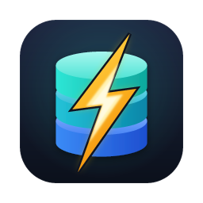

<p align="center">
  
</p>

<h1 align="center">Cache Deck</h1>

<p align="center">A fast desktop client for Redis and Valkey: connect, browse, edit, run commands and watch your servers.</p>

## Features

- **Dashboard of all your servers.** One table with every saved connection: online or offline, Redis or Valkey and its version, memory use against its limit, key count, operations per second and when you last used it. It refreshes every 20 seconds. You can search, filter by environment (Production, Staging, Development, Local) and sort by column.
- **Saved connections.** Host, port, username, password, database number, connection timeout, TLS (with an option to skip the certificate host name check, for tunnels and port forwards), an environment tag and the server type (auto-detect, Redis or Valkey). There is a *Test connection* button.
- **Key browser.** Search by pattern, filter by type, load more as you go, and see each key's type and expiry at a glance.
- **Value editor.** View and edit strings (with JSON formatting), hashes, lists, sets and sorted sets. You can add keys, rename, delete and set or remove an expiry. Streams and JSON values are shown read-only.
- **Command box.** Run any command, with replies formatted like `redis-cli`, history (↑/↓) and suggestions (Tab) from a built-in list and from the server itself.
- **Server info.** Memory, CPU, operations per second, hit ratio, clients and keys, plus every `INFO` section.
- **Dark and light themes**, remembered between runs.

Tested against Valkey 9.1 and Redis 7.4.

## Build and run

You need [Rust](https://rustup.rs) (stable).

```sh
cargo run --release
```

### Mac app

```sh
sh packaging/macos/bundle.sh   # builds dist/Cache Deck.app for this Mac's chip
open "dist/Cache Deck.app"
```

For a disk image that runs on both Apple Silicon and Intel Macs:

```sh
rustup target add aarch64-apple-darwin x86_64-apple-darwin   # once
sh packaging/macos/dmg.sh      # builds dist/cache-deck-<version>-macos-universal.dmg
```

The package carries the app's name, icon and About details. It is signed only for the Mac it was built on ("ad hoc"). To share it with other people it needs a Developer ID signature and notarization.

### Windows

Build on Windows itself, so the icon and version details can be put into the program:

```sh
cargo build --release       # target\release\cache-deck.exe
```

Release builds open no console window, so `--help` and error messages print nothing there. Debug builds (`cargo build`) keep the console.

The installer is made with [Inno Setup](https://jrsoftware.org/isinfo.php) from `packaging/windows/installer.iss`:

```sh
iscc /DAppVersion=0.1.0 packaging\windows\installer.iss   # out\cache-deck-0.1.0-windows-x86_64-setup.exe
```

It installs for the current user without an administrator password, and adds a Start Menu entry and an uninstaller.

### Linux

```sh
cargo build --release       # target/release/cache-deck
strip -s target/release/cache-deck
cargo install cargo-deb cargo-generate-rpm   # once
cargo deb --no-build        # target/debian/cache-deck_<version>_<arch>.deb
cargo generate-rpm          # target/generate-rpm/cache-deck-<version>-1.<arch>.rpm
```

The `.deb` (Debian, Ubuntu) and the `.rpm` (Fedora, Red Hat, openSUSE) install the program, an app-menu entry (`packaging/linux/cache-deck.desktop`) and the icon. Building needs the usual window-system development libraries; on Debian or Ubuntu:

```sh
sudo apt-get install libxkbcommon-dev libwayland-dev libgl1-mesa-dev libxcb-render0-dev libxcb-shape0-dev libxcb-xfixes0-dev
```

### Release builds on GitHub

`.github/workflows/release.yml` builds all three systems on GitHub's own machines:

| System | Chip | Files |
|---|---|---|
| Windows | x86_64 | `cache-deck-<version>-windows-x86_64-setup.exe` (installer), `…-windows-x86_64.exe` (the program by itself), `…-windows-x86_64.zip` (the program and README) |
| Linux | x86_64 | `cache-deck_<version>_amd64.deb`, `cache-deck-<version>-1.x86_64.rpm`, `cache-deck-<version>-linux-x86_64.tar.gz` |
| Linux | ARM | `cache-deck_<version>_arm64.deb`, `cache-deck-<version>-1.aarch64.rpm`, `cache-deck-<version>-linux-arm64.tar.gz` |
| macOS | Apple Silicon and Intel | `cache-deck-<version>-macos-universal.dmg` |

- **To release:** set the version in `Cargo.toml`, then push a matching tag (`v0.1.0` for version `0.1.0`). The workflow creates a draft release with the files attached; press Publish on GitHub when it looks right.
- **To try the builds without releasing:** run the workflow by hand from the Actions tab. The files stay attached to that run.

None of the files are signed with a paid certificate, so Windows shows a SmartScreen warning and macOS asks for confirmation before the first start. The Windows and Linux builds haven't been tested on real machines yet.

### Command-line options

| Option | What it does |
|---|---|
| `--screenshot <file.png>` | Start without taking focus, draw ~120 frames, save the window as a PNG and quit |
| `--connect <host:port>` | Connect right away (not saved) |
| `--select <key>` | Open this key after connecting |
| `--tab <keys\|commands\|info\|new\|about>` | Start on a given screen or dialog |
| `--light` | Start in the light theme |
| `--run <command>` | Run a command in the Commands tab after connecting (repeatable) |

Craft Anything's build check also starts the app with `--screenshot`, so that option has to keep working without a server or any input.

## Settings

Saved connections and the theme are stored in a JSON file that only your user account can read:

- macOS: `~/Library/Application Support/CacheDeck/config.json`
- Linux: `~/.config/CacheDeck/config.json`
- Windows: `%APPDATA%\CacheDeck\config.json`

Passwords are stored in this file as plain text (not in the system keychain). Set `CACHE_DECK_CONFIG=/path/to/file.json` to use another file, for example when testing.

## Tests

```sh
cargo test                                   # unit tests
valkey-server --port 6391 --save "" --daemonize yes
CACHE_DECK_TEST_PORT=6391 cargo test         # adds live edit tests (uses and empties database 5)
```

## Project layout

```
src/
  main.rs         command-line options, window setup, screenshot mode
  app.rs          the whole user interface (dashboard, keys, commands, info, dialogs)
  worker.rs       talks to the server on a background thread; reply formatting
  config.rs       saved connections and preferences
  theme.rs        colours and egui styling
  commands.rs     built-in command list for suggestions
  platform/       code for one system only; everything above is shared
    macos.rs      fills the macOS "About Cache Deck" window
assets/app-icon/  the icon as SVG, PNG sizes, .icns and .ico
packaging/
  macos/          Mac app packaging (Info.plist template, credits, bundle and disk-image scripts)
  linux/          app-menu entry for Linux (cache-deck.desktop)
  windows/        build.rs puts the icon and version details into the .exe; installer.iss builds the installer
.github/workflows/release.yml   builds Windows, Linux and macOS files for a release
LICENSE           MIT licence
```

Built with [egui/eframe](https://github.com/emilk/egui) and [redis-rs](https://github.com/redis-rs/redis-rs).

## How it was built

Cache Deck was first built with Craft Anything 0.6.1, a desktop tool from the ArtCraft Team that turns a written request into a working app. It drove Claude Code as the builder and checked every build by compiling it and starting it with `--screenshot`. Development continues in this repository.

## Developer

**Shaon Dey**: [github.com/ShaonDey](https://github.com/ShaonDey)

## Licence

MIT. See [LICENSE](LICENSE).

Redis is a trademark of Redis Ltd. Valkey is a trademark of the Linux Foundation. Cache Deck is an independent project and isn't affiliated with either.
